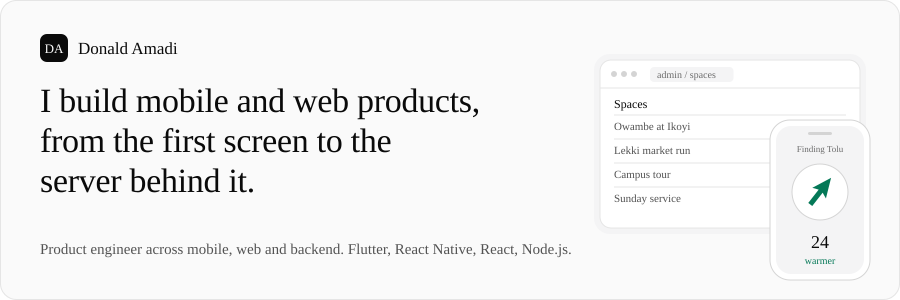

<picture>
  <source media="(prefers-color-scheme: dark)" srcset="assets/hero-dark.svg">
  
</picture>

Five years shipping mobile apps, mostly in fintech, plus the web apps and Node services behind them. Open to senior product engineering roles across mobile, web and the backend.

**[Portfolio](https://donaldamadi.dev)** &nbsp;|&nbsp; [CV](https://donaldamadi.dev/cv) &nbsp;|&nbsp; [LinkedIn](https://www.linkedin.com/in/donald-amadi-7b95b817a/) &nbsp;|&nbsp; [Email](mailto:donaldamadi15@gmail.com)

### Building now

<a href="https://pindey.app">
  <picture>
    <source media="(prefers-color-scheme: dark)" srcset="assets/pindey-dark.svg">
    
  </picture>
</a>

Every layer is mine: Flutter app, Next.js site and back office, NestJS API on PostgreSQL and Redis. [Try the walkthrough](https://pindey.app/try).

### Selected work

- **Ofin Eko**: Lagos State law, offline and read aloud. Solo, React Native, on both stores.
- **[ExtraCash](https://donaldamadi.dev/work/extracash-embedded-lending)**: embedded lending inside a live banking app. Flutter.
- **[MedPal Provider](https://donaldamadi.dev/work/medpal-telemedicine)**: video consultations for doctors, in two languages. Flutter.
- **Uplines**: React web app and native iOS widgets.

More, with the decisions behind them, on [donaldamadi.dev](https://donaldamadi.dev/#work).

### Open source

- [**flutter_skill_gen**](https://pub.dev/packages/flutter_skill_gen): writes `SKILL.md` files so coding assistants know your Flutter codebase
- [**multi_image_layout**](https://pub.dev/packages/multi_image_layout): lays out image and video grids for you

**Stack:** React Native, React, Next.js, TypeScript, Flutter, Swift, Kotlin, Node.js, NestJS, PostgreSQL, Redis
