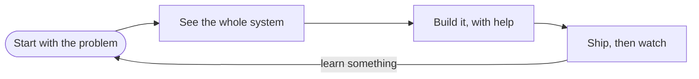

<picture>
  <source media="(prefers-color-scheme: dark)" srcset="assets/hero-dark.svg">
  
</picture>

I'm a product engineer in Lagos with five years of shipping mobile apps, mostly in fintech, where a rounding error ruins someone's day and *"works on my machine"* has never saved anybody. I work in **React Native**, **Flutter**, and native **Swift** and **Kotlin** on mobile, **React**, **Next.js** and **TypeScript** on the web, and **Node.js** on the server.

**Right now:** building [PinDey](https://pindey.app), and open to React Native and senior product engineering roles, remote or relocating.

[Portfolio](https://donaldamadi.dev) &nbsp;|&nbsp; [CV (PDF)](https://donaldamadi.dev/cv) &nbsp;|&nbsp; [LinkedIn](https://www.linkedin.com/in/donald-amadi-7b95b817a/) &nbsp;|&nbsp; [Email](mailto:donaldamadi15@gmail.com)

## PinDey

<a href="https://pindey.app">
  <picture>
    <source media="(prefers-color-scheme: dark)" srcset="assets/pindey-dark.svg">
    
  </picture>
</a>

You're at an owambe, your people are "by the bar", and there are five bars. A pin on a map is tens of metres off and won't tell you which way to walk, so PinDey gives you an arrow, a distance and the old warmer or colder game. My favourite decision in it: when the phone can't tell which way to point, it says *"very close, look around"* instead of guessing. No location history, positions gone about two minutes after the last update, nothing sold.

I built every layer of it, in one TypeScript monorepo against a single OpenAPI contract:

| Surface | Built with |
| :-- | :-- |
| Mobile app | Flutter, iOS and Android |
| Website and no-install browser tools | React, Next.js App Router, Tailwind, Cloudflare via OpenNext |
| Back office | React, Next.js, server-only data access, two-factor sign-in |
| API and realtime | Node.js, NestJS on Fastify, PostgreSQL + PostGIS, Redis, BullMQ, WebSockets, a transactional outbox, idempotency keys |

[Try the walkthrough](https://pindey.app/try) or [see it on my portfolio](https://donaldamadi.dev/#pindey).

## Selected work

| Project | What it is | Built with |
| :-- | :-- | :-- |
| **Ofin Eko** | Every law of Lagos State in English or Yorùbá, offline and read aloud. Built solo, on the App Store and Google Play. | React Native |
| **[ExtraCash](https://donaldamadi.dev/work/extracash-embedded-lending)** | Embedded lending inside a live banking app: open-banking eligibility, instant disbursement, card repayment. | Flutter |
| **[Encrypted transport](https://donaldamadi.dev/work/aes-encrypted-transport)** | A networking layer that survives its key rotating mid-transfer, replaying every request exactly once. | Flutter |
| **[MedPal Provider](https://donaldamadi.dev/work/medpal-telemedicine)** | Video and voice consultations for doctors, in English and Spanish, with CI that fails on translation drift. | Flutter, Agora |
| **[Card-present POS](https://donaldamadi.dev/work/pos-platform-channels)** | A Flutter screen driving a vendor's Java card reader SDK over platform channels. | Flutter, Kotlin, Java |
| **Uplines** | A web and mobile platform. I worked on the React web app and built native iOS widgets. | React, SwiftUI |
| **Adduce** | An early-stage SaaS producing signed accessibility-compliance evidence for EN 301 549 and the EAA. | React, PostgreSQL |

Case studies for the linked projects, with the decisions I made and the ones I turned down, are on [donaldamadi.dev](https://donaldamadi.dev/#work).

## What I work with

| | |
| :-- | :-- |
| **Mobile** | React Native, Flutter, Swift and SwiftUI, Kotlin, platform channels |
| **Web** | React, Next.js (App Router), TypeScript, Tailwind CSS |
| **Backend** | Node.js, NestJS, Fastify, Express, PostgreSQL + PostGIS, Prisma, Redis, BullMQ, WebSockets |
| **Testing and shipping** | Playwright, Vitest, axe-core, GitHub Actions, Bitrise, Shorebird, Sentry, Vercel, Cloudflare |
| **Fintech** | Wallets and ledgers, lending, card-present payments, open banking (Mono), KYC, Flutterwave, Paystack |

## Open source

- **[flutter_skill_gen](https://pub.dev/packages/flutter_skill_gen)**: a CLI that reads a Flutter project and writes `SKILL.md` files, so coding assistants start out knowing its architecture and conventions.
- **[multi_image_layout](https://pub.dev/packages/multi_image_layout)**: lays out image and video grids so you never do that maths by hand again.

## How I work

I use AI coding tools the way I use a good IDE. Tests and my own review still decide what ships.

## Writing

- [Your AI coding assistant is brilliant, but also has amnesia](https://thatmandonald.medium.com/your-ai-coding-assistant-is-brilliant-but-also-has-amnesia-42e2e8a4db0b) (Level Up Coding, 2026)
- [Debugging your Flutter applications remotely](https://thatmandonald.medium.com/debugging-your-flutter-applications-remotely-6ded44d46bc) (Level Up Coding, 2023)
- [Implementing Firebase dynamic linking in your Flutter app](https://thatmandonald.medium.com/implementing-firebase-dynamic-linking-in-your-flutter-app-3e9290dd3bc0) (Level Up Coding, 2022)

When I'm not writing about software, I'm writing poetry and prose. Finding the right word and finding the right abstraction are pretty much the same muscle.

<b>Got five minutes? The long version.</b>

 

I started out building the part of software you hold in your hand. For years that was the whole world: a release train, a store review queue, and a phone somewhere with two bars of signal that the app still had to feel fast on. Most of those years were in fintech, at a bank, a lender, a wallet, a payments company. I still think the empty states and the offline path are where you find out who really cared.

The tools changed more than once along the way. Most of my mobile years were in Flutter, with native Swift and Kotlin whenever the platform needed it. Ofin Eko I built alone in React Native. On the web I live in React, Next.js and TypeScript, which is also what makes React Native feel like home: same components, same hooks, same way of thinking about state.

Somewhere along the way the job got bigger than the screen. I kept following the bug past the API call, then past the server, into the database and the queue and the cron job nobody remembered writing, and realised I was an engineer who happened to know mobile very well. That's how PinDey happened: one product, every layer mine, and nobody to hand the hard part to. Honestly, that's the fun bit.

---

Think about the problem, see the system, build the thing. Then make it quiet.
